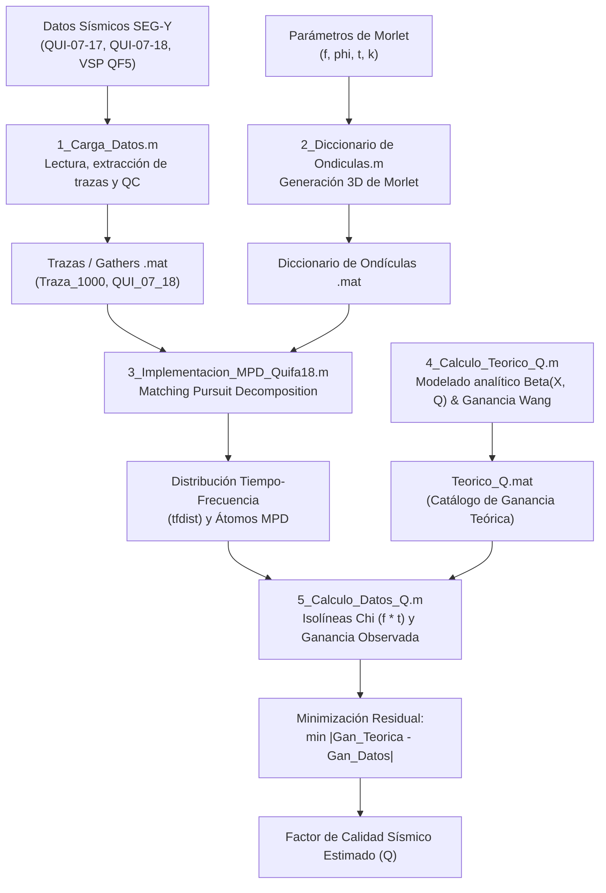

# Estimación del Factor de Calidad Sísmico ($Q$) mediante Descomposición Matching Pursuit (MPD)

Repositorio con el código en **MATLAB** desarrollado para la investigación y tesis de maestría sobre atenuación anelástica sísmica y estimación del **Factor de Calidad ($Q$)**, aplicado a datos sísmicos de superficie (líneas sísmicas 2D de la zona de Quifa: `QUI-07-17` y `QUI-07-18`) y registros de pozo / sísmica vertical (VSP).

---

## 📋 Tabla de Contenido
1. [Descripción General](#-descripción-general)
2. [Fundamento Metodológico](#-fundamento-metodológico)
3. [Estructura del Repositorio](#-estructura-del-repositorio)
4. [Flujo de Trabajo Paso a Paso](#-flujo-de-trabajo-paso-a-paso)
   - [Paso 1: Carga y Preprocesamiento de Datos Sísmicos](#paso-1-carga-y-preprocesamiento-de-datos-sísmicos)
   - [Paso 2: Generación del Diccionario de Ondículas de Morlet](#paso-2-generación-del-diccionario-de-ondículas-de-morlet)
   - [Paso 3: Descomposición Matching Pursuit (MPD) y Análisis Tiempo-Frecuencia](#paso-3-descomposición-matching-pursuit-mpd-y-análisis-tiempo-frecuencia)
   - [Paso 4: Modelado de Curvas Teóricas de Atenuación y Ganancia ($Q$)](#paso-4-modelado-de-curvas-teóricas-de-atenuación-y-ganancia-q)
   - [Paso 5: Cálculo e Inversión de $Q$ sobre Datos Sísmicos Reales](#paso-5-cálculo-e-inversión-de-q-sobre-datos-sísmicos-reales)
5. [Diagrama del Pipeline](#-diagrama-del-pipeline)
6. [Datos y Almacenamiento](#-datos-y-almacenamiento)
7. [Requisitos y Dependencias](#-requisitos-y-dependencias)
8. [Consideraciones de Ejecución](#-consideraciones-de-ejecución)

---

## 🔬 Descripción General

A medida que una onda sísmica viaja a través del subsuelo, experimenta dispersión y disipación de energía elástica debido a efectos anelásticos y de fricción interna en la roca y fluidos presentes en los poros. Esta pérdida de energía dependiente de la frecuencia se cuantifica mediante el **Factor de Calidad Sísmico ($Q$)**.

Este proyecto implementa una metodología robusta para estimar $Q$ que combina:
1. **Descomposición Espectral de Alta Resolución:** Uso del algoritmo *Matching Pursuit Decomposition* (MPD) con un diccionario redundante de ondículas complejas de Morlet para descomponer cada traza sísmica en átomos individuales con fase, frecuencia, tiempo y amplitud bien determinados.
2. **Distribución Tiempo-Frecuencia (TF):** Representación precisa de la energía en el plano tiempo-frecuencia libre de artefactos de interferencia (cross-terms) típicos de Wigner-Ville.
3. **Compensación de Amplitudes e Inversión de $Q$ (Metodología Wang):** Proyección de la energía en isolíneas del producto tiempo-frecuencia ($\chi = \omega t = 2\pi f t$), modelado analítico de curvas de ganancia estabilizadas y búsqueda por optimización del valor de $Q$ que minimiza la diferencia entre las curvas observadas y teóricas.

---

## 🧠 Fundamento Metodológico

### 1. Ondícula Compleja de Morlet
El diccionario se construye mediante ondículas de Morlet complejas parametrizadas por frecuencia central $f$, tiempo $t$, fase $\phi$ y parámetro de ancho espectral $k$:

$$m(t; f, \phi) = \exp\left( -t^2 \cdot f^2 \cdot \ln(2/k) \right) \cdot \exp(i 2\pi f t) \cdot \exp(i \phi)$$

### 2. Matching Pursuit Decomposition (MPD)
Una traza sísmica $s(t)$ se descompone de forma voraz (*greedy*) e iterativa:

$$s(t) = \sum_{n=1}^{N} A_n \, m_n(t) + R_N(t)$$

donde en cada paso se selecciona el átomo $m_n$ con máxima correlación con la señal residual $R_{n-1}(t)$ hasta que la energía relativa caiga por debajo de un umbral (`cutoff`, e.g., $0.1\%$).

### 3. Estimación de $Q$ por Compensación de Amplitud Estabilizada
El factor de decaimiento teórico de la amplitud con la propagación es:

$$\beta(\omega, t; Q) = \exp\left(-\frac{\omega t}{2Q}\right) = \exp\left(-\frac{\pi f t}{Q}\right)$$

Para evitar inestabilidades numéricas en altas frecuencias o tiempos tardíos, se incorpora una cota máxima de ganancia $G_{\lim} = 20\text{ dB}$, obteniendo una ganancia estabilizada:

$$\sigma = \exp(-(0.23 \cdot G_{\lim} + 1.63))$$

$$\text{Ganancia}(X, Q) = \frac{\beta + \sigma}{\beta^2 + \sigma}$$

Comparando la ganancia calculada sobre los datos observados a lo largo de las isolíneas $X = f \cdot t$ frente a un catálogo teórico parametrizado por $Q \in [1, 150]$, se minimiza la función objetivo:

$$Q_{\text{opt}} = \arg\min_{Q} \sum_{X} \left| \text{Gan}_{\text{datos}}(X) - \text{Gan}_{\text{teórica}}(X, Q) \right|$$

---

## 📁 Estructura del Repositorio

```text
Attenuation_Q/
├── 1_Matlab_Code/
│   ├── 1_Carga_Datos.m                   # Lectura de archivos SEG-Y y extracción de trazas/gathers
│   ├── 2_Diccionario de Ondiculas.m     # Generación del diccionario de Morlet para datos sísmicos (0-200 Hz)
│   ├── 2_Diccionario de Ondiculas_VSP.m # Generación del diccionario de Morlet para VSP (0-250 Hz, dt=1ms)
│   ├── 3_Implementacion_MPD_Quifa18.m   # Descomposición MPD en trazas de la línea Quifa 18
│   ├── 3_Implementacion_MPD_VSP.m       # Descomposición MPD adaptada a datos VSP (pozo QF5)
│   ├── 4_Calculo_Teorico_Q.m            # Generación de curvas teóricas de decaimiento y ganancia (Wang)
│   ├── 5_Calculo_Datos_Q.m              # Mapeo isolíneas Chi (f*t), cálculo de ganancia real y minimización de Q
│   └── 5_Calculo_Datos_Q_1480.m         # Variante del cálculo de Q para análisis a nivel de horizonte/tiempo específico
├── 2_Data/
│   └── Link_Data.txt                    # Enlace a Google Drive con los volúmenes SEG-Y y matrices .mat
└── README.md                            # Documentación técnica del proyecto
```

---

## 🚀 Flujo de Trabajo Paso a Paso

### Paso 1: Carga y Preprocesamiento de Datos Sísmicos
* **Script:** [`1_Matlab_Code/1_Carga_Datos.m`](file:///Users/efrainlav/Attenuation_Q/1_Matlab_Code/1_Carga_Datos.m)
* **Objetivo:** Importar los volúmenes sísmicos originales en formato SEG-Y a matrices nativas de MATLAB.
* **Acciones principales:**
  1. Utiliza `read_segy_file` o `altreadsegy` para leer gathers pre-apilados de las líneas `QUI-07-17_GATHERS.sgy` y `QUI-07-18_GATHERS.sgy`.
  2. Extrae trazas específicas (ej. traza 1000) o subconjuntos (trazas 1 a 100).
  3. Establece el vector de tiempos basado en la tasa de muestreo `sampint` (típicamente $2\text{ ms} = 0.002\text{ s}$).
  4. Genera gráficos de control de calidad mediante wiggle plots (`wiggle`) y gráficas de amplitud vs. tiempo.
  5. Guarda los resultados en archivos `.mat` (`Traza_1000.mat`, `QUI_07_17.mat`, `QUI_07_18.mat`).

---

### Paso 2: Generación del Diccionario de Ondículas de Morlet
* **Scripts:**
  * [`1_Matlab_Code/2_Diccionario de Ondiculas.m`](file:///Users/efrainlav/Attenuation_Q/1_Matlab_Code/2_Diccionario%20de%20Ondiculas.m) (Sísmica 2D de superficie)
  * [`1_Matlab_Code/2_Diccionario de Ondiculas_VSP.m`](file:///Users/efrainlav/Attenuation_Q/1_Matlab_Code/2_Diccionario%20de%20Ondiculas_VSP.m) (Sísmica de pozo VSP)
* **Objetivo:** Sintetizar una base redundante de átomos de Morlet en 3 dimensiones: $[Frecuencia \times Fase \times Tiempo]$.
* **Parámetros clave:**
  * Frecuencias: $f \in [2, 200]\text{ Hz}$ (superficie) o $[2, 250]\text{ Hz}$ (VSP).
  * Fases: $\phi \in [-180^\circ, +180^\circ]$ con resolución de $1^\circ$.
  * Ventana temporal: $[-0.5\text{ s}, +0.5\text{ s}]$ con tasa de muestreo de $2\text{ ms}$ ($ns=500$) o $1\text{ ms}$ ($ns=1000$).
  * Parámetro de ciclos de la ondícula: $k = 0.2$.
* **Salida:** Archivos matriciales `diccionario_Qui_07_18_0_198.mat` o `diccionario_VSP_QF5.mat`, con visualización volumétrica de cortes con `slice`.

---

### Paso 3: Descomposición Matching Pursuit (MPD) y Análisis Tiempo-Frecuencia
* **Scripts:**
  * [`1_Matlab_Code/3_Implementacion_MPD_Quifa18.m`](file:///Users/efrainlav/Attenuation_Q/1_Matlab_Code/3_Implementacion_MPD_Quifa18.m)
  * [`1_Matlab_Code/3_Implementacion_MPD_VSP.m`](file:///Users/efrainlav/Attenuation_Q/1_Matlab_Code/3_Implementacion_MPD_VSP.m)
* **Objetivo:** Descomponer trazas sísmicas seleccionadas (o secciones sísmicas completas) en átomos elementales de ondículas y calcular la distribución espectral instantánea.
* **Procedimiento:**
  1. Carga el diccionario de ondículas previamente calculado y la traza/sección sísmica (ej. `Traza300.mat`).
  2. Calcula la energía inicial de la señal (`energycalc`).
  3. Ejecuta el bucle `while perc_energ > cutoff` (con criterio de parada en $0.001$, es decir, $99.9\%$ de energía explicada):
     * Determina los atributos complejos óptimos con `cmplxattrib` (amplitud, tiempo de arribo, fase y frecuencia dominante).
     * Selecciona y escala la ondícula correspondiente del diccionario 3D.
     * Resta el átomo de la traza para obtener el nuevo residuo (`wavesubadd`) y acumula la traza modelada.
  4. Genera la distribución de tiempo-frecuencia libre de artefactos mediante `TimeFreqDistElm` o `TimeFreqDistElmVSP`.
  5. Despliega los espectrogramas resultantes mediante `imagesc` con mapa de color `jet`.

---

### Paso 4: Modelado de Curvas Teóricas de Atenuación y Ganancia ($Q$)
* **Script:** [`1_Matlab_Code/4_Calculo_Teorico_Q.m`](file:///Users/efrainlav/Attenuation_Q/1_Matlab_Code/4_Calculo_Teorico_Q.m)
* **Objetivo:** Construir la base de referencia teórica de decaimiento y ganancia compensada para un rango amplio de posibles valores de $Q$.
* **Procedimiento:**
  1. Discretiza el espacio de búsqueda:
     * Variable de propagación $X \in [1, 450]$.
     * Factor de calidad $Q \in [1, 150]$ con paso de $0.01$.
  2. Calcula la matriz teórica de atenuación: $\text{BetaQ}(X, Q) = \exp\left(-\frac{2\pi X}{2Q}\right)$.
  3. Modela la ganancia estabilizada aplicando el límite $G_{\lim} = 20\text{ dB}$ (parámetro de estabilización de Wang).
  4. Genera figuras de control que ilustran el comportamiento de la ganancia en función de $Q$ y guarda la base teórica en `Teorico_Q.mat`.

---

### Paso 5: Cálculo e Inversión de $Q$ sobre Datos Sísmicos Reales
* **Scripts:**
  * [`1_Matlab_Code/5_Calculo_Datos_Q.m`](file:///Users/efrainlav/Attenuation_Q/1_Matlab_Code/5_Calculo_Datos_Q.m)
  * [`1_Matlab_Code/5_Calculo_Datos_Q_1480.m`](file:///Users/efrainlav/Attenuation_Q/1_Matlab_Code/5_Calculo_Datos_Q_1480.m)
* **Objetivo:** Extraer la trayectoria de energía observada en el plano tiempo-frecuencia y estimar el $Q$ óptimo por ajuste de curvas.
* **Procedimiento:**
  1. **Construcción del espacio $\chi$ ($X = t \cdot f$):** A partir del espectrograma `tfdist`, se calcula la matriz producto tiempo por frecuencia y se identifican las isolíneas de $X$.
  2. **Integración de Amplitudes por Isolínea:** Suma las amplitudes al cuadrado ($\text{Amplitud} = \sum \text{tfdist}^2$) para cada valor constante de $X$, generando la curva observada `vectorX`.
  3. **Cálculo de la Ganancia Real (`Gan_datos`):** Normaliza la curva observada respecto a su valor máximo y aplica la formulación de compensación estabilizada con $G_{\lim} = 20\text{ dB}$.
  4. **Optimización y Minimización del Residual:**
     * Compara `Gan_datos` contra cada columna de `Gan_Teorica` ($Q \in [1, 150]$).
     * Calcula la norma residual $L_1$: $\text{valores}(Q) = \sum |\text{Gan\_Teorica}(:, Q) - \text{Gan\_datos}|$.
     * Identifica el valor óptimo: `[Qcalculado, timeloc] = min(valores)`.
  5. Grafica las curvas de desajuste, la ganancia observada y el $Q$ óptimo obtenido.

---

## 📊 Diagrama del Pipeline



---

## 💾 Datos y Almacenamiento

Debido al volumen de los registros sísmicos (archivos SEG-Y de gathers pre-apilados, migraciones PSTM y registros de pozo), la información binaria se encuentra disponible externamente:

* **Enlace de Descarga:** [Google Drive - Datos de Tesis](https://drive.google.com/drive/folders/0BwTVqqdbDZRLQVRKdWk2azl2QU0?usp=sharing) (especificado en [`2_Data/Link_Data.txt`](file:///Users/efrainlav/Attenuation_Q/2_Data/Link_Data.txt)).
* **Contenido del repositorio de datos:**
  * Archivos SEG-Y de las líneas `QUI-07-17` y `QUI-07-18`.
  * Volúmenes migrados PSTM (`Quifa_18_PSTM.mat`).
  * Trazas extraídas y gathers por CDP (e.g. CDPs en torno a pozos RB-4 y RB-53).
  * Diccionarios pre-calculados (`diccionario_Qui_07_18.mat`, etc.).

---

## 🛠 Requisitos y Dependencias

* **MATLAB:** Versión R2016a o superior (compatible con versiones modernas).
* **Toolboxes de MATLAB recomendados:**
  * *Signal Processing Toolbox* (cálculo espectral, convolución, análisis de señales).
  * *Image Processing Toolbox* (visualización de espectrogramas y matrices 3D).
* **Toolboxes Geofísicos Externos:**
  * **SegyMAT** o **CREWES MATLAB Toolbox:** Necesario para funciones de entrada/salida de formato SEG-Y (`read_segy_file`, `write_segy_file`, `altreadsegy`, `s_wplot`).
* **Funciones de Matching Pursuit:**
  * Los scripts invocan rutinas auxiliares para el proceso de descomposición voraz:
    * `cmplxattrib`: Estimación de atributos complejos instantáneos.
    * `energycalc`: Cálculo de energía de traza/residuo.
    * `wavesubadd`: Sustracción de ondículas y reconstrucción de señal.
    * `TimeFreqDistElm` / `TimeFreqDistElmVSP`: Construcción de la matriz tiempo-frecuencia ponderada por los átomos.

---

## ⚠️ Consideraciones de Ejecución

1. **Rutas de Archivos en MATLAB:**
   * Los scripts originales contienen rutas absolutas vinculadas al entorno de trabajo donde se desarrolló la tesis (por ejemplo `J:\Estudio\Maestria\Tesis\DATA\...` o `F:\OneDrive\UNAL\...`).
   * Antes de ejecutar los scripts, actualice las llamadas `read_segy_file` o `load` para que apunten a rutas relativas dentro de la carpeta `2_Data/` o a la ubicación donde haya descargado los datos de Google Drive.
2. **Costo Computacional de MPD:**
   * La descomposición Matching Pursuit sobre secciones sísmicas multitraza completas con diccionarios de alta densidad es computacionalmente intensiva.
   * Se recomienda iniciar pruebas sobre trazas individuales (ej. `Traza300.mat` o `Traza_1000.mat`) o subsecciones acotadas de CDPs antes de procesar líneas sísmicas completas.
3. **Criterio de Parada:**
   * El parámetro `cutoff = 0.001` en el paso 3 define el umbral de energía residual ($0.1\%$). Si se requiere mayor velocidad de cómputo en fases exploratorias, este umbral puede ajustarse temporalmente a $0.01$ ($1\%$).
